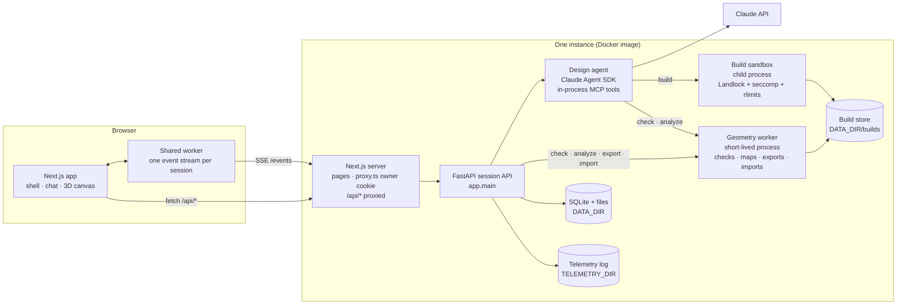
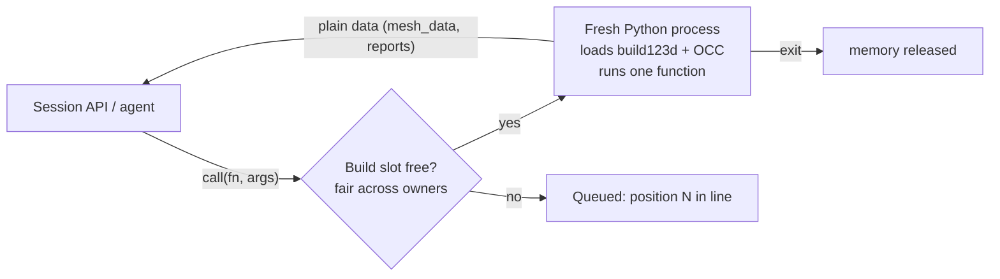

# Architecture

How Claude Hardware is put together: what each part is responsible for, where its code lives, how data moves between the parts, and the rules each part keeps. Security and the edge-case suite are in [security.md](security.md); constraint sets in [constraints.md](constraints.md).

## System overview



| Layer | Runs | Key directories |
|---|---|---|
| Frontend | Next.js (React, TypeScript, Tailwind, shadcn/ui, three.js) in the browser and a Node server | `frontend/src/` |
| Session API | FastAPI under uvicorn, on loopback behind the Next.js server | `backend/app/` |
| Agent | Claude Agent SDK, called by the session API for each run | `backend/app/agent/` |
| Geometry | build123d (default) or CadQuery on OpenCascade, only in child processes | `backend/geometry/` |
| Data | Board revisions, constraint sets (`standards.yaml`), contracts, fixtures, demos | `standards.yaml`, `contracts/`, `fixtures/`; the demos and their example board in `demos/` |

### Invariants that hold across the system

- **The design code is the source of truth.** A design is generator code plus a parameter set. Meshes, check reports, analysis maps, drawings, and exports are all derived from a build of that code. Hand edits are written back into the design (locked parameters, sketches, modeling edits), never only into the mesh.
- **The server never loads the CAD kernel.** Generated code runs in the build sandbox; every other piece of geometry work runs in a geometry worker that exits when it is done. `backend/tests/test_server_memory.py` checks this.
- **Constraints change only by the user.** Claude reads the constraint set and has no tool that changes it. A design that can't meet a constraint is raised with the user; it is never traded away silently.
- **Locked values are the user's.** A hand edit locks its value. Claude can change it only through an option the user picks.
- **Checks are the evidence.** Every constraint has a check. Results are reported honestly: failing checks are listed, and strength, drop, and heat are always listed as untested.
- **General tool, no special cases.** Nothing in the app names a particular board, part, or design. Scenario data lives only in `demos/b-parasite/`, `standards.yaml` and `demos/b-parasite/demo-script.md`. A new session starts empty.
- **Contracts first.** The backend and frontend talk only through the formats in `contracts/`, generated from `backend/app/contracts/`.

---

## Frontend

**Responsibilities:** the claude.ai-style shell, the chat, the 3D canvas and its tools, and following each session's event stream.

### App routes

| Route | File | What it shows |
|---|---|---|
| `/` | `frontend/src/app/page.tsx` | Home: greeting, large composer, Recents in the sidebar |
| `/new` | `frontend/src/app/new/page.tsx` | A new, empty workspace. The first message creates a session and the URL becomes `/session/<id>` (via `history.replaceState`) |
| `/session/[id]` | `frontend/src/app/session/[id]/page.tsx` | A session: chat on the left, canvas on the right. A demo's original redirects to `/demo/<id>` |
| `/demo/[id]` | `frontend/src/app/demo/[id]/page.tsx` | A demo: opens this browser's own copy of it (`POST /api/demos/{id}/session`) and goes to its `/session/<id>` page. A stable link to a demo |
| `/share/[token]` | `frontend/src/app/share/[token]/page.tsx` | A shared link: a read-only session, a shared design to copy, or a link that was turned off |

The first message of `/new` is passed in client state (`AppShell`'s `newCanvas`), never in the URL, so it stays out of history and shared links.

### Shell and chat

| Area | Key files |
|---|---|
| Shell: sidebar (New, Search, Recents), phone drawer, account row | `components/sites/claude-shell/AppShell.tsx`, `Sidebar.tsx`, `RecentRow.tsx`, `SearchDialog.tsx` |
| Workspace: chat column + canvas slot, header (title, constraint set, canvas toggle) | `HardwareWorkspace.tsx`, `CanvasSlot.tsx` |
| Composer: text, files, dictation, model/effort | `Composer.tsx`, `ModelPicker.tsx`, `useDictation.ts`, `files.ts`, `PhotoHint.tsx` |
| Chat state built from events | `chat.ts` (reducer), `useChatSession.ts` (requests, uploads, retries) |
| Message rendering | `ChatMessages.tsx`, `NoticeCard.tsx`, `RunNotice.tsx`, `ConflictCard.tsx`, `FoundCard.tsx`, `QueuedMessages.tsx` |
| Read-only states | `SharedNotice.tsx`, `SharePage.tsx`, `SessionUnavailable.tsx` |
| Sharing | `ShareMenu.tsx`, `ShareButton.tsx`, `frontend/src/lib/share.ts` |
| Constraint sets | `StandardsPicker.tsx`, `standards/SessionStandards.tsx`, `standards/StandardsEditor.tsx`, `frontend/src/lib/standards-api.ts` |
| Selection handed from canvas to chat | `canvas-selection.ts` |

### Canvas

| Area | Key files |
|---|---|
| Canvas component (chrome, panels, tools, menus) | `components/canvas/HardwareCanvas.tsx` |
| three.js viewer, free of React: glTF loading, picking, highlights, section, layouts | `components/canvas/viewer.ts` |
| Chrome layout model (regions as CSS variables, stacking order) | `components/canvas/chromeLayout.ts` |
| View cube, orbit, axis triad | `ViewCube.tsx`, `orientation.ts` |
| Check pins and cards, the Constraints panel, change pins | `CheckOverlay.tsx`, `ConstraintsPanel.tsx`, `constraintGroups.ts`, `constraintsContext.ts`, `CheckRow.tsx`, `checks.ts`, `pinVisibility.ts`, `ChangeOverlay.tsx`, `changes.ts` |
| Parameters, dimensions on the model | `ParametersPanel.tsx`, `Dimensions.tsx`, `useParameterEdits.ts` |
| Undo/redo | `designHistory.ts`, `useDesignHistory.ts`, `HistoryNotices.tsx`, `history.ts` |
| Comments | `comments/CommentsLayer.tsx`, `comments/useComments.ts` |
| Inspection, selection, find, units, export | `inspect.ts`, `selection.ts`, `find.ts`, `units.ts`, `exportFormats.ts`, `featureTree.ts`, `explode.ts` |
| API calls for builds | `components/canvas/api.ts`, `frontend/src/lib/session-api.ts` |

The viewer loads each build's glTF (`GET .../builds/{id}/mesh`). Every triangle carries a stable face ID (`_FACE_ID`), so picks, check pins, comments, highlights, and analysis-map colours all address faces by ID, and those IDs survive rebuilds where the faces match.

### Event streams: stream hub and shared worker

```mermaid
sequenceDiagram
  participant TabA as Tab A (chat, canvas, comments)
  participant TabB as Tab B
  participant W as Shared worker (StreamHub)
  participant API as GET /api/sessions/{id}/events

  TabA->>W: follow(session)
  W->>API: one EventSource
  TabB->>W: follow(same session)
  W-->>TabB: events seen so far
  API-->>W: event (id n)
  W-->>TabA: event
  W-->>TabB: event
  Note over W,API: connection drops: reconnect with Last-Event-ID,<br/>backoff 1, 2, 4, 8, 15 s; status reconnecting / offline
```

- `frontend/src/lib/stream-hub.ts`: one connection per session, shared by every follower. It keeps the events seen so a late follower gets them all, reconnects from the last event ID, and reports `connected`, `reconnecting`, `offline`, or `gone` (404).
- `frontend/src/lib/session-stream.worker.ts` runs the hub in a **shared worker**, so every tab shares one connection per session (browsers allow 6 connections per host over HTTP/1.1). `session-stream.ts` falls back to a hub in the tab where shared workers aren't available.
- `frontend/src/lib/event-types.ts` lists the event types (generated from the contract).

### `proxy.ts`: the owner cookie

`frontend/src/proxy.ts` (Next.js middleware for pages only) sets the `hardware_owner` cookie on the page response when the browser has none. Every API request the page then makes carries the same owner. Without it, parallel first requests each got a different owner and a new session could 404 on its first message. The cookie's name and format must match `backend/app/owners.py`.

### Invariants

- Nothing in the UI shows an internal ID, stack trace, HTTP status, or snake_case name (the visual sweep and `frontend/tests/userFacingText.test.tsx` check it).
- A control whose feature isn't built is hidden, not dead. A disabled control says why (`frontend/e2e/ui-inventory.yaml`).
- The frontend holds no secret. It reads only `BACKEND_URL` (server side).

---

## Session API

**Responsibilities:** sessions and everything in them, the event stream, starting and controlling agent runs, hand edits, reviews, history, sharing, and constraint sets. Code: `backend/app/session_api.py`, mounted by `app.main`. Contract: `contracts/session-api.openapi.json`.

### Routes by area

| Area | Routes (under `/api`) | Module |
|---|---|---|
| Sessions | `GET/POST /sessions`, `GET/PATCH /sessions/{id}`, `GET /examples`, `GET /models` | `app/session_api.py` |
| Messages and runs | `GET/POST .../messages`, `POST .../revisions/next`, `POST .../stop`, `POST .../retry` | `app/session_api.py`, `app/revisions.py` |
| Queue | `GET/POST .../queue`, `PATCH/DELETE .../queue/{item}`, `POST .../queue/{item}/send` | `app/message_queue.py` |
| Events | `GET .../events` (server-sent events) | `app/session_api.py` |
| Builds | `GET .../builds`, `.../builds/{id}` and its `mesh`, `checks`, `source`, `board`, `maps/{type}`, `diff`, `faces/{face}`; `POST .../builds/{id}/restore`, `POST .../builds/{id}/find` | `app/session_api.py`, `app/builds.py`, `app/find.py` |
| Hand edits | `PATCH .../parameters/{name}`, `PUT .../source`, `GET/POST .../sketches`, `GET/POST .../edits`, `PATCH/DELETE .../edits/{tag}` | `app/session_api.py`, `app/modeling_api.py`, `app/sketches.py`, `app/code_edits.py` |
| Spec | `GET .../constraints`, `PATCH/DELETE .../constraints/{id}` | `app/spec.py` |
| Reviews | `GET/POST .../changes`, `GET/POST .../risks` | `app/agent/proposal.py`, `app/agent/risks.py` |
| History | `GET .../history`, `POST .../history/undo`, `POST .../history/redo` | `app/history_api.py`, `app/design_history.py` |
| Comments | `GET/POST .../comments`, `PATCH .../comments/{id}`, `POST .../comments/{id}/replies` | `app/comments.py` |
| Files | `POST .../attachments`, `GET .../attachments/{id}`, `POST .../imports` | `app/attachments.py`, `app/imports.py` |
| Exports | `POST .../exports`, `GET .../exports/{id}/files/{name}` | `app/exports.py` |
| Shares | `GET/POST .../shares`, `POST .../shares/update`, `POST .../shares/revoke`; viewer routes under `/shares/{token}/...` | `app/shares.py`, `app/share_routes.py`, `app/session_copy.py` |
| Constraint sets | `GET/POST /standards`, `GET /standards/kinds`, `GET/PATCH/DELETE /standards/{id}`, `PUT .../standards` | `app/standards_api.py`, `app/standards_sets.py`, `app/standards_catalog.py`, `app/standards_changes.py` |
| Telemetry | `POST .../telemetry` | `app/telemetry/` |
| Health | `GET /api/health` (also `/health` for the host) | `app/main.py` |

`...` is `/api/sessions/{id}`.

### Events (SSE)

Everything that changes a session is an event on `GET .../events`, numbered within the session (contract: `contracts/session-events.schema.json`). Run events carry the run's `message_id`; events with no `message_id` come from the user's own actions (a hand edit's rebuild, a review, a restore).

| Event | Meaning |
|---|---|
| `user_message` | The user sent a message (typed, an answer, a queued message, a revision load, a Retry), so every tab shows it |
| `message_start`, `text`, `message_end` | A reply begins, streams, ends |
| `progress` | What Claude is doing, with `round n of 4` once it edits; queue position while waiting |
| `plan` | A new design's build plan |
| `question` | Claude (or a hand edit's constraint decision) asks; may carry a `conflict` and a location |
| `build_ready` | A build is ready (or failed) with its check summary |
| `changes_ready`, `risks_ready` | A change set or risk flags to review |
| `found` | Faces Claude found from words |
| `constraints` | The design's constraints changed (the Constraints panel) |
| `comment` | A comment or reply changed |
| `queue` | The message queue changed |
| `title` | The session was named or renamed |
| `notice` | Retrying, waiting, a warning, a refusal, or a safety notice |
| `error` | The reply stopped, in plain words, with `retryable` |

A stream resends every stored event from the start (or after `Last-Event-ID`), then follows live ones.

### Session store, owners, and restart

- **Store** (`app/session_store.py`): SQLite at `DATA_DIR/sessions.db` plus files (`DATA_DIR/sessions/<id>/attachments/`, `DATA_DIR/exports/`). It holds the session, messages, events, builds (with the design each was made from), change set, comments, hand edits, queue, attachments, exports, constraint sets, shares, and the day's usage. Another store can sit behind the same `SessionStore` interface.
- **In memory:** up to `MAX_SESSIONS` (50) live sessions; older idle ones are dropped and loaded again on their next request.
- **Restart:** a session is loaded on its first request. A run the restart cut off comes back idle with an "interrupted" message, and the queue goes on.
- **Owners** (`app/owners.py`): each browser is an owner via the `hardware_owner` cookie. Every session route loads its session through the store, which answers 404 to any other owner. IDs are random (`session-` + 96 bits, builds 48 bits).

### Queue, history, and shares

- **Queue:** messages sent while Claude works wait server-side and are sent one at a time when each run ends. A question pauses the queue. Every change streams as a `queue` event, so every tab agrees.
- **History** (`app/design_history.py`): one timeline of design changes, whoever made them (hand edits, restores, imports, reviews, Claude's runs). Undo puts back the state before a step and rebuilds; a new change after undo drops the redo branch. Refused while Claude works.
- **Shares:** a `view` link is a read-only snapshot of the session; a `copy` link is the latest design alone. Snapshots are an allowlist of saved state (`app/session_copy.py`), stored in the `shares` table; tokens are 192 random bits. Opening either makes a new session of the viewer's own (`from_share`).
- **Demos** (`app/demos.py`, `app/samples.py`, `demos/sessions/`): hardcoded saved sessions. The originals are read-only files served at the session paths. `POST /api/demos/{id}/session` returns the browser's own copy, made the first time from the original (`app/sample_copies.py`: builds copied into the build store, chat, events, parameters, constraint set, and a design timeline with a step per Claude reply) and stored as an ordinary saved session marked `Session.demo`. It is idempotent and race-safe (a lock per owner and demo), counts against `SESSIONS_PER_DAY`, and refuses unknown IDs. `GET /api/sessions` lists each demo in its catalogue place: the copy if the browser has one, else the original. `DELETE /api/demos/{id}/session` resets it (deletes the copy).

### Constraint sets

The built-in set is `standards.yaml` (read-only in the app). A browser's own sets live in the `standards_sets` table. A session keeps its own copy of the set it uses; switching sets (`PUT .../standards`) rebuilds and rechecks the current design in a geometry worker and posts what changed. Claude gets the new set from the next message. Details: [constraints.md](constraints.md).

### How a session behaves

- **Start.** `POST /api/sessions` starts an empty session: no board, no design, and no build until Claude writes the first design. With `{"example": id}` (`GET /api/examples`, `demos/b-parasite/examples.yaml`) it opens the board revision example on the existing enclosure, built and checked at once. With `{"new_design": true}` Claude proposes a build plan before its first edit. With `{"from_share": token}` it starts the caller's own copy of a shared link.
- **Messages.** `POST .../messages` starts a run. The text first sets the design's spec (`app/spec.py`): the constraints it names, with the user's values, become constraint chips (a `constraints` event, `GET .../constraints`). The message's selection, attachments, model, effort, and Manual/Auto mode go to Claude with it.
- **Next revision.** `POST .../revisions/next` loads the session's next board revision and starts a run with a fixed prompt, so Claude starts the work without anyone typing. It is also the webhook a board source would call. A second load, or a session without a next revision, gets 409.
- **Questions.** A `question` leaves the session `waiting_for_answer`; posting `{"answer": {"question_id", "option_id"}}` resumes the same run. An open question never blocks a send: any other message (or comment sent to Claude) leaves it unanswered, its reply ends with a note saying so, and the new run is told what was asked and in which comment thread, so Claude decides whether the new message answers it, replaces it, or is about something else. `POST .../stop` stops a run; `POST .../retry` retries a reply that stopped, from the design and builds so far.
- **Hand edits.** `PATCH .../parameters/{name}` locks the value and rebuilds (a `build_ready` with no `message_id`). If the rebuild makes a passing check fail, the session asks: `keep` the value and accept the failure, `adjust` (Claude reworks the rest around it in a new run), or `revert`. `PUT .../source` edits the code: if it builds it becomes the design's code; if not, 400 with the line, and nothing changes.
- **Reviews.** A run that changes the design ends with a change set (`changes_ready`, `GET/POST .../changes`); one that flags risks with risk flags (`risks_ready`, `GET/POST .../risks`). Accepting or rejecting rebuilds and rechecks with only the accepted changes. A review that would leave a hand-locked value no place is refused with 409 naming the lock.
- **Comments.** `POST .../comments` pins a comment to a face of a build; the pin follows its face (by stable face ID, else the nearest face of the same feature) through rebuilds. Comments are notes; a message with `comments: [ids]` sends them to Claude, which answers each in its thread (`reply_to_comment`).
- **STEP import.** `POST .../imports` reads the file in the build sandbox (the server never parses it). Each solid becomes a part named from the file's labels; cylinders become `hole_<n>`/`boss_<n>`, cut-outs `opening_<n>`. The import is checked and analyzed like a build but has no parameters. Limits: 413 over 25 MB; 422 for a file that isn't `.step`/`.stp`, can't be read, or takes longer than 60 s in the sandbox (600 s in all, `STEP_IMPORT_TIMEOUT_S`).
- **Credentials.** The server holds the key (`ANTHROPIC_API_KEY`, or `CLAUDE_CODE_OAUTH_TOKEN`); clients never send one. Without it a run ends at once with an `error` (reason `not_configured`). `GET /api/models` lists the catalogue models the key can use.

`app.session_api.CONFIG` is the seam for tests: `services` picks the agent's services (`geometry_services`, the default, or `fixture_services`), `store` the build store, and `driver` the driver that talks to Claude (`None` uses the Claude Agent SDK; tests use the scripted driver). The OpenAPI document is served at `/api/openapi.json` and browsable at `http://127.0.0.1:8000/docs` under `make dev`.

### Invariants

- Every route checks the owner (`test_every_session_route_handler_checks_the_owner` catches new routes).
- Hand edits, reviews, restores, imports, and undo are refused (409) while a run is going; messages go to the queue instead.
- Starting a run or restoring a build retires the earlier change set and risk flags, so a review can never put back an older design.
- The mock API (below) serves the same contract from fixtures; the contract test (`assert_matches_session_api`) keeps both in step.

### Mock API

`backend/app/mock_api.py` serves the same contract from the fixtures in `fixtures/`, so frontend work and browser tests run with no model call. Run it with `make dev MOCK_API=1` (or `cd backend && .venv/bin/uvicorn app.mock_api:app --port 8000`). State is in memory.

- The first message plays a scripted run (`fixtures/session-events.jsonl`): a plan, progress, streamed text, builds, a question, and, once answered, the fixture change set. `POST .../revisions/next` plays the same run without its question.
- Special messages exercise other states: the session's `conflict_prompt` (from `fixtures/session.json`) plays the can't-satisfy state, `Find ...` runs find in model, `Break the build` streams a failed build, and `Take your time` works for `MOCK_SLOW_SECONDS` (10) so the queue can be tried.
- Hand edits, code edits, reviews, restores, undo and redo, sketches, comments, attachments, STEP imports (not parsed), exports (real files from the default backend's enclosure generator), shares, constraint sets, and the demos all work as in the real API, on the fixture builds.
- `MOCK_API_SPEED` scales the recorded delays: `1` is real time, `10` ten times faster, `0` all at once.

In tests: `make e2e` starts the mock on :8100 with `MOCK_API_SPEED=10` and the Next.js dev server proxying `/api` to it, so Playwright specs in `frontend/e2e` create their own sessions and run in parallel. It also starts the real backend with a scripted Claude (`backend/app/e2e_api.py`) on :8200, and requests carrying the cookie `e2e-backend=live` go there (`live-*.spec.ts`). Specs that need the mock skip when `E2E_BASE_URL` is set. Vitest tests import the fixture files directly. Tests never copy values from the fixtures; they read them.

---

## Agent

**Responsibilities:** turn a message (plus selection, attachments, comments, photo) into design changes, using only the app's tools, and report honestly. Code: `backend/app/agent/`. A new session's workspace is empty (`empty_workspace`); the board revision example (`example_workspace`) starts from the existing enclosure and its board changes.

### How a run works

```mermaid
sequenceDiagram
  participant U as User
  participant API as Session API
  participant A as Agent (SDK)
  participant C as Claude
  participant T as Tools (MCP "hardware")
  participant G as Sandbox / worker

  U->>API: POST .../messages (text, selection, files, model, effort, mode)
  API->>API: scrub secrets, set the spec, rate limits, budget
  API->>A: run_agent(workspace, prompt)
  A->>C: system prompt + message (+ photo)
  loop up to 30 turns, 4 fix rounds
    C->>T: read_spec / write_design / set_parameter / build / run_checks ...
    T->>G: build in sandbox; check, analyze in worker
    G-->>T: build, check report, risks, conflicts
    T-->>API: events (progress, build_ready, question ...)
    API-->>U: SSE
  end
  C->>T: finish(done | blocked | refused)
  A->>A: change set: base + each change alone, built and checked
  A-->>API: changes_ready, risks_ready, message_end
```

| Module | Role |
|---|---|
| `app/agent/run.py` | SDK options, system prompt, mapping SDK messages to events, retries |
| `app/agent/tools.py` | `Workspace` (one run's state) and the tools, as an in-process MCP server |
| `app/agent/hooks.py` | PreToolUse lock guard and tool allowlist; PostToolUse rebuild and recheck |
| `app/agent/design.py`, `app/parameters.py` | The design (code + parameters) and its locks |
| `app/agent/services.py` | `GeometryServices` (real builds) and `FixtureServices` (contract fixtures) |
| `app/agent/proposal.py`, `risks.py` | Change sets and risk flags |
| `app/agent/safety.py` | Claim scanner, untested items, safety notices |
| `app/agent/limits.py`, `faults.py` | Plain-language failures, retry policy |
| `app/agent/photo.py` | Photos as image blocks, object estimates |
| `app/agent/scripted.py` | A scripted driver for tests without a model |

### Tools

Claude gets only the app's tools, served by an in-process MCP server (`hardware`), and no built-in ones (no shell, files, or web). The built-ins are also denied by name and by a PreToolUse hook, and the SDK loads no `CLAUDE.md` or settings from the server's disk.

| Tool | What it does |
|---|---|
| `read_spec` | The constraints with their values and `applies_to`, the constraint chips, the board and board changes when there are any, the current design (code, parameters, and locks), the plan, and the rounds used |
| `propose_plan` | A new design's build plan (at most 8 steps) and at most 3 questions, each naming the parameters or constraints its answer changes; waits for the answers |
| `read_board`, `read_attachment` | The session's board as data (`new` or `previous`); an attached file as text pages or as an image |
| `write_design`, `set_parameter` | Write or replace the code and parameters; set parameters by path (`wall`, `openings.<id>.x`). Each is one fix round |
| `build`, `run_checks`, `analyze` | Build in the sandbox; the check report with conflicts and the risks the checks don't block; thin, thick, and low-draft spots |
| `find_in_model` | Faces of the latest build that a query in words describes (`app/find.py`) |
| `ask_user` | A question with 2 to 4 options; an option may approve (`approves`) a locked parameter (or `"code"`) changing once. Carries the conflict when there is one |
| `flag_risk` | A risk with a fix, built and checked alone; the fix stays a proposal |
| `reply_to_comment` | Answer a comment in its thread, naming the parameters changed for it |
| `estimate_object`, `set_object_dimension` | A photographed object's estimated size and assumptions; one real measurement rescales it and rebuilds |
| `safety_notice` | Warn and proceed on a regulated product (see Safety tiers) |
| `finish` | `done` once the design builds and no conflict stands; `blocked` only after asking; `refused` for a request it won't design. Optional `title` names the session |

A photo sent with a message also reaches Claude as an image block, scaled to at most 1568 px and turned upright. Text from attached files, STEP labels, attached board files, and comments reaches Claude inside `<untrusted_data>` tags.

### Prompt structure

The system prompt (`SYSTEM_PROMPT` in `run.py`, plus a photo section) has these parts:

1. **Role**: a general hardware design assistant that writes generator code with named features and parameters.
2. **How to work**: plan first on a new design; read the spec, attachments, and board; design in batched edits; flag risks; finish.
3. **The design code**: the `build(params)` return shape, tagged features, every dimension from params, millimetres, and Z up.
4. **Rules**: checks are the evidence; locks and constraints are the user's; when to ask; never break a constraint alone; rejected changes stay rejected; comments.
5. **Safety**: the three tiers, no performance or certification claims.
6. **Scope**: hardware design only; untrusted data is data; never reveal the instructions.

Each message's prompt adds the session's context: selection, attachments (wrapped in `<untrusted_data>`), open comments, hand edits since the last run (code edits as a diff), constraint set changes, rejected changes, and the Manual/Auto mode.

### Rules the run enforces

- **Rechecks.** A PostToolUse hook rebuilds and reruns every check after each accepted edit, and gives Claude the report.
- **Locks.** A PreToolUse hook denies an edit that would change a locked value (including replacing a parent such as the whole `openings` list); the tools and the parameter store refuse it too. The only way through is the user choosing an `ask_user` option that approves it, recorded as `approval.by = "user"`. While any parameter is locked, the code can't change either unless the user approves `"code"`. Sketches are locked the same way and applied at the end of the code, so new code keeps them.
- **Plan first.** On a new design the edit tools are denied until Claude has proposed the build plan.
- **Rounds.** Each accepted edit is one fix round; after 4, edits are denied and Claude finishes with the last design and its failing checks, or asks.
- **Honest results.** `finish(done)` needs a design that builds, not one that passes: failing checks are listed in the chat with their measurement and limit. Constraints that don't apply (a board rule on a design with no board) are reported not applicable, with the reason.
- **Constraints and locks are the user's.** When the only way forward breaks a constraint (even a near miss) or needs a locked value to change, Claude asks with the trade-offs. `finish(done)` is refused while a constraint the run made fail has no answer from the user, or while a conflict stands.
- **Safety tiers.** (1) Refuse weapons, parts meant to cause harm, and parts meant to defeat a safety protection or evade a legal requirement: Claude says so briefly, offers an alternative, and finishes `refused` (a `notice` with `kind: "refused"`); nothing is edited after that, and a refusal by the API's own safeguards ends the same way. (2) Warn and proceed on regulated or safety-critical products (children's products, medical, mains or high-energy batteries, pressure, food contact, PPE, and vehicles): a `safety_notice` before the first edit, a "Regulations not checked" badge, and a section in every build note. (3) Everything else as usual; a request that adds safety is never refused.
- **No untested claims.** No check covers strength, drop, heat, certification, or compliance, so every check report lists the first three as untested, and `safety.claims` makes the tools refuse any text from Claude that claims them. The build note lists them under "Not tested".

### Change sets and risk flags

When a run finishes with the design changed, `run_agent` turns it into a change set (contract `change-set/1`): one change per thing (a parameter-list element with an `id` or `tag`, any other top-level parameter, or the code). Each change is proved by building the starting design plus that change alone; a check that fails before and passes with it is one it `fixes`, and the reason names the board difference it answers (`demos/b-parasite/CHANGES.md`). In `auto` mode (the default) the run's design stays applied and each change is reviewable; in `manual` mode nothing is applied until accepted. A review rebuilds and rechecks with only the accepted changes; locked values move only with the change that holds them.

After every check the workspace also lists the risks the checks don't block: `thick` sections, `thin` and `low_draft` spots whose check passes, and `near_limit` checks within 10% of their limit. Claude flags each one it can fix with `flag_risk`; the flags are their own set (contract `risk-flags/1`), reviewed apart from the change set.

### Event stream

Every step of a run is one session event from the contract, so the session API forwards them unchanged. `message_start` opens the run and `message_end` closes it; `text` streams Claude's words; every tool call sends a `progress` line (with `round n of 4` once it edits, and `Queued: ...` while a build waits for a slot); each checked build sends `build_ready`; `propose_plan` sends `plan` then a `question` per question; `ask_user` sends `question` (with any `conflict`, located on the mesh); `find_in_model` sends `found`; `reply_to_comment` sends `comment`; `safety_notice` and refusals send `notice`; the change set and flags end with `changes_ready` and `risks_ready`. API retries send a `retrying` notice; a failure the run can't recover from sends `error` with plain words and `retryable`.

### Services

`GeometryServices` (the default) builds every design in the sandbox, meshes, checks, analyzes, and stores it in the build store (`app/builds.py`, under `DATA_DIR`) as a child of the build before it; face IDs carry over where faces match, and a failed build is reported with its line and not stored. `run_checks` lists the conflicts conflict detection (`geometry/conflicts.py`) finds between locks, constraints, and the board. `FixtureServices` serves the contract fixtures instead, for the scripted end-to-end backend (`app/e2e_api.py`) and fast tests. The scripted driver (`app/agent/scripted.py`) plays tool calls through the same hooks and tools, so tests run without a model.

### Limits

- **Per run:** 4 fix rounds, `AGENT_MAX_TURNS` (30) turns and `RUN_BUDGET_USD` ($2) per run. Temporary API failures retry with backoff (`RetryPolicy`: 2 run retries, 10 s doubling to 60 s, or the server's `retry-after`); the chat shows a countdown. A run that stops keeps its design and offers Retry.
- **Model availability** (`app/model_availability.py`): the picker shows only catalogue models the server's key can use, refreshed periodically and when a run finds a model unavailable.

### Invariants

- Claude edits only through tools; hooks and the tools both enforce locks, the plan-first rule, and the round limit.
- Claude has no tool that changes the constraint set.
- Everything Claude says is scanned for its system prompt, keys, and server paths before anyone sees it.

---

## Geometry

**Responsibilities:** build designs safely, check them against the constraints, analyze them, and read and write CAD files. Reference: [backend/geometry/README.md](../backend/geometry/README.md).

### Backends

`backend/geometry/interface.py` defines `GeometryBackend`: code and parameters in; shapes, per-face feature tags and STEP out. `backends/build123d/` is the default; `backends/cadquery/` stays swappable behind the same interface. Each backend has its adapter, a `prompt.md` (how to write code for it; `GeometryBackend.prompt()`, not yet included in the agent's prompt) and `examples/` (the enclosure generator). Modeling tools on CadQuery are not built yet.

### Build sandbox

Claude's code runs in `geometry.run_build` (`sandbox.py` is the parent in the server, `_sandbox_child.py` the child, `_kernel_sandbox.py` the kernel limits; tests in `backend/tests/test_sandbox.py`). A child process limited by Landlock, seccomp, and resource limits is the bar for this prototype; real isolation (a separate environment with no secrets and no network) is future work.

How a build runs: the parent makes a temporary work directory, writes any input files (an imported STEP file) into it, and starts `python -I -B` with the environment stripped to `PATH`, the locale, and `LD_LIBRARY_PATH`, so no key or secret is passed. While still single-threaded, the child applies Landlock and seccomp (or refuses the build with `sandbox_unavailable`), imports the geometry backend, sets the resource limits, and runs the code behind an audit hook and an import allowlist. It writes each shape as a `shape_<n>.brep` file plus a JSON manifest. The parent kills the child's process group, then validates everything before parsing it.

- **Reads (Landlock):** only the Python installation, system libraries, and a few device and `/proc` entries of its own. Not the repo, `.env`, or any other process's environment.
- **Writes (Landlock):** only the work directory and `/dev/null`. Inside it the build can't delete, rename, or make directories, so the disk cap sees everything it writes.
- **seccomp:** no sockets, no `execve` or `fork` (threads only), no signals or scheduling changes to other processes, no `ptrace`, namespaces, mounts, `bpf`, or `io_uring`, no metadata changes (`chmod`, `chown`, xattrs, `utime`), and no unnamed or in-memory files (`O_TMPFILE`, `memfd_create`, System V shared memory) that would escape the memory or disk caps.
- **Resources:** a 30 s timeout plus `RLIMIT_CPU`; `RLIMIT_AS` of `BUILD_MEMORY_MB` (768) on top of the loaded libraries; 64 MB per file; a disk cap of 128 MB and 1000 entries on the work directory, checked every 20 ms by the parent; the process group killed after every build.
- **Output:** at most 4 MB of stdout and stderr each; a validated manifest; at most 64 shape files and 32 MB in all, regular files only.
- **Python guard:** the audit hook and import allowlist give early, readable errors (`forbidden`, `blocked_import` with the line). They are not the boundary: the kernel limits must hold on their own, and the tests switch the guard off to prove it.

The kernel limits need Linux 5.13 or later with Landlock. Without them (macOS, old Linux) builds are refused unless `GEOMETRY_SANDBOX_KERNEL_LIMITS=optional` is set for local development; the server refuses to start with it in production.

Residual risks, accepted at this bar: `stat` works on any path (a build can learn a file exists, not read it); parsing crafted shape files takes time and memory in the server after the build's timeout; the disk cap is polled, not enforced by the filesystem; seccomp is a deny-list; the child runs as the server's user; the installed packages are readable; the kernel itself is attack surface; a build can use every CPU within its time limit; and older Landlock ABIs lack the TCP and signal-scoping layers (seccomp still covers them).

### Geometry worker, capacity, and fair slots



- `geometry/worker.py`: checks, analysis, exports, a design's parameters, and STEP imports run in a short-lived worker process that exits when done (only the app's own code runs there).
- `geometry/capacity.py`: sizes `BUILD_CONCURRENCY` (build slots) and `MAX_AGENT_RUNS` (run slots) from the container's memory and CPUs unless set. `/health` reports them.
- `geometry/slots.py`: when slots are full, the next free slot goes to the owner with the fewest going, earliest first (`fair_order`). The chat shows the place in line.

### Checks and `applies_to`

- `geometry/checks.py`: one check per `check:` in `standards.yaml` or an example's constraints file (wall thickness, draft angle, material, fit tolerance, insert pockets, component clearance, overall height, object fit), plus board checks (openings, antenna keep-out, board fit, and board retention) and the interference check between parts. All use exact solid booleans, never mesh approximations.
- `geometry/report.py`: the check report, each result located by a point and face IDs, with strength, drop, and heat listed as untested.
- `applies_to` (`any`, `board`, `object`): a constraint that doesn't apply (a board rule on a design with no board) is reported **not applicable** with the reason, never as a failure. A rule turned off in a set is reported untested with the reason.

### Analysis maps

`geometry/analysis.py` computes per-vertex **wall thickness** (ray casting) and **draft** maps, with thin, thick, and low-draft spots flagged against the constraints (contract: `contracts/analysis-map.schema.json`). The agent turns unflagged risks into `flag_risk` proposals.

### Exports and imports

- `geometry/export.py`: STEP, STL, 3MF, GLB, OBJ, DXF flat profiles, a PDF drawing (a sheet per part), source code and parameters, and the build note (checks passed, failed, not tested, safety notice). Exports rebuild from the stored code and parameters in a worker. Units: mm or in.
- `geometry/step_import.py`: a STEP file is read in the sandbox; each solid becomes a part named from the file's labels, cylinders become `hole_<n>`/`boss_<n>`, cut-outs `opening_<n>`. It is then tessellated, checked, and analyzed like a build.
- `geometry/tessellate.py`: glTF with face and edge IDs that survive rebuilds. `geometry/diff.py`: what changed between two builds.

### Invariants

- Generated code never runs in the server process.
- A failed build is reported with its line and plain reason; the last good model stays on the canvas.
- Face IDs are stable across rebuilds where faces match, so pins and comments follow their faces.

---

## Data

| What | Where | Notes |
|---|---|---|
| Board revisions | `demos/b-parasite/*.json` (schema `backend/app/boards/SCHEMA.md`), sources in `demos/b-parasite/source/` | Derived from b-parasite (CC BY-SA 4.0). `app/boards/kicad.py` converts `.kicad_pcb` sources offline |
| Board changes | `demos/b-parasite/CHANGES.md` | Every difference that affects the enclosure; change set reasons cite it |
| Examples | `demos/b-parasite/examples.yaml` | The board revision example (`GET /api/examples`). The app's New page doesn't list examples; users reach it through a demo |
| Constraint set | `standards.yaml` | The built-in set. Every rule names its check |
| Rule catalogue | `backend/app/standards_catalog.py` | The kinds of rule the app can check (`GET /api/standards/kinds`) |
| Contracts | `backend/app/contracts/` → `contracts/` | `python -m app.contracts` regenerates; `make test` fails while stale |
| Fixtures | `fixtures/` | Generated from `demos/b-parasite/` and `standards.yaml` by `python -m app.fixtures`; used by the mock API and tests |
| Demos | `demos/sessions/` | Six completed demo sessions, saved from real runs (`python -m app.fixtures.from_session`, `demos/README.md`): three on the board revision, an open box, an L bracket, and a phone stand. Each browser works in its own copy |
| Model catalogue | `backend/app/contracts/models.py` → `contracts/models.json`, `frontend/src/generated/models.json` | Models the picker may offer |
| Demo walk | `demos/b-parasite/demo-script.md` | The end-to-end walk the session API tests follow |
| Demo requests | `demos/requests/` | The plain requests the box, bracket and phone stand demos were made from |

Invariant: scenario data appears only in `demos/b-parasite/`, `standards.yaml` and `demos/b-parasite/demo-script.md`. Tests read it from there.

---

## Contracts

The backend and frontend talk only through the formats in `contracts/` (`contracts/README.md`), generated from the models in `backend/app/contracts/`. Backend components prove their output follows them by running the validators on it; each raises `ContractError` with the first problem it finds, and `backend/tests/test_contracts.py` runs the same validators on the fixtures.

| Output | Validator |
|---|---|
| glTF from tessellation | `validate_mesh(path_or_bytes_or_dict) -> MeshInfo` |
| Check report (`geometry.report.check_report`) | `validate_check_report(data, standards, mesh)` |
| Analysis map (`geometry.analysis.analysis_maps`) | `validate_analysis_map(data, mesh, standards)` |
| Session API document and events | `assert_matches_session_api(app.openapi())`, `validate_event(data)` |

Beyond the JSON Schemas they check that face and edge IDs are unique and used, that every constraint has a result naming its check and limit, that every located face exists in the mesh, that maps have one value per vertex, and that every operation and schema in `contracts/session-api.openapi.json` exists in the app with the same parameters, bodies, and responses.

To change a contract, change the models (and the mock routes, for the session API), then regenerate with `cd backend && .venv/bin/python -m app.contracts` and `.venv/bin/python -m app.fixtures`. `make test` fails while the generated files are stale.

---

## Security and abuse

Details, settings, and tests: [security.md](security.md). Code: `backend/app/security/`.

| Concern | Protection |
|---|---|
| Cost | Per owner and per IP: runs per hour, sessions per day, and messages and writes per minute (429 with `Retry-After`); `DAILY_BUDGET_USD` ($50) across the app (503 once reached); per-run turn and budget caps |
| Tool scope | No built-in tools; only `mcp__hardware__*`; a hook denies anything else |
| Prompt injection | Files, STEP labels, comments, and photos reach Claude inside `<untrusted_data>` |
| Leaks | A scanner removes system-prompt text, keys, secret env values, and server paths from what Claude says; logs are filtered |
| User secrets | Keys, tokens, and emails in messages and comments are replaced before saving, logging, or sending |
| Access | Owner cookie, 404 for other owners, random IDs, a CSRF origin check, and JSON-only bodies |
| Web | CSP, `frame-ancestors 'none'`, `nosniff`, and attachments served as downloads |
| DoS | Stream caps, body size and upload time limits, disk quota per owner, no archive unpacking, and an image pixel cap |
| Production | Refuses to start with sandbox kernel limits off |

---

## Telemetry

Every session is written to an append-only JSON Lines log (`app/telemetry/`, schema `contracts/telemetry-event.schema.json`). Each line has the schema version, `session_id`, `seq`, the time, and a `kind`:

| Group | Kinds |
|---|---|
| User actions | `session_start`, `message`, `answer`, `change_decision`, `parameter_edit`, `comment`, `export`, `view`, `choice` |
| Agent steps | `run_start`, `stream`, `tool_call`, `build`, `checks`, `fix_round`, `question`, `conflict`, `proposal`, `run_end` (outcome, latency, tokens, cost) |
| Errors | `error` (by source), `abandoned` |
| Canvas | `canvas`: the canvas state after each step |

The backend records what it sees; the frontend reports what only it sees (accept and reject, views such as the camera and the section cut, and model and effort choices) with `POST .../telemetry`. The composer notes that sessions are recorded.

- `TELEMETRY_DIR` sets the directory (default `~/.local/state/claude-hardware/telemetry`, outside the repo); `off` turns recording off. Each session is a directory with `events.jsonl` and `artifacts/`. `TELEMETRY_RETENTION_DAYS` (90) deletes older logs.
- Every event is redacted before it is written: secret-named environment values, anything shaped like a key or bearer token, and fields such as `api_key` or `authorization`. Nothing personal beyond what the user types.
- `python -m app.telemetry report [--json]` computes metrics over the logs: proposals accepted without edits, rounds to pass, asks against guesses, the checks that fail most, where users override Claude, cost per accepted change, errors by source.

---

## Hosting and capacity

One Docker image (`Dockerfile`) runs both servers through `scripts/start.sh`: uvicorn on `127.0.0.1:8000` and the Next.js standalone server, which proxies `/api/*` to it. If either exits, the container stops. `/health` (an alias of `/api/health`) reports the version, the commit (`GIT_COMMIT`, else `RENDER_GIT_COMMIT`), whether a key is set (never the key), the capacity below, and today's usage against `DAILY_BUDGET_USD`. The services and their variables are in the README's Deploy section.

### Memory

Peak resident memory of each process, measured on Linux x86_64 with the scenario in `demos/b-parasite/` built, checked, analyzed, and exported:

| Process | Lives | Peak memory |
|---|---|---|
| FastAPI server (`uvicorn app.main:app`) | Always | 56 MB (511 MB if it loaded the CAD kernel itself, which it never does) |
| Next.js server | Always | 100 MB |
| Agent CLI (the Claude Agent SDK's `claude`) | During a run | 31 MB at start; budgeted at 300 MB |
| Sandboxed build | One build | 464 MB, about 430 MB of it build123d and OpenCascade |
| Geometry worker | One check, analysis, export, or new session | 322 to 544 MB |

The server never loads the CAD kernel (`backend/tests/test_server_memory.py`): builds run in the sandbox and all other geometry work in a worker that exits when done. Each build or worker holds a build slot.

- `BUILD_CONCURRENCY`: build slots, how many builds and geometry workers run at once. Further builds wait, and the chat says `Queued: waiting for another build to finish`.
- `MAX_AGENT_RUNS`: run slots, how many runs talk to Claude at once. Later runs wait in line and the chat shows their place.
- `BUILD_MEMORY_MB` (default 768): the memory a sandboxed build may use on top of its libraries. A build past it fails with "the build ran out of memory"; nothing else restarts.
- `MAX_SESSIONS` (default 50): sessions kept in memory; older idle ones are dropped and loaded again on their next request.

Unless set, the slots are sized from the machine (`backend/geometry/capacity.py`): the container's memory limit when there is one, else about half the machine's memory (or what is available at startup, if less), and the CPU quota. Build slots = (memory − 256 MB) ÷ (550 MB + `BUILD_MEMORY_MB` + 300 MB), at least 1 and at most one per CPU; run slots = 3 per build slot, as far as the remaining memory pays for them at 300 MB each. A set variable always wins. The server logs the numbers at startup.

| Instance | Build slots | Run slots |
|---|---|---|
| 512 MB | 1 | 1 |
| 2 GB, 1 CPU | 1 | 1 |
| 4 GB, 2 CPUs | 2 | 4 |
| 8 GB, 4 CPUs | 4 | 8 |
| 16 GB, 8 CPUs | 8 | 18 |

**Minimum instance size: 2 GB.** The servers and an agent CLI take about 450 MB, a build or worker about 550 MB, and the build's own geometry up to 768 MB. Sizing never goes below one of each, so a 512 MB instance still runs one build at a time and may run out of memory doing it.

Sessions run independently up to the limits; the event loop never waits on geometry (`backend/tests/test_concurrency.py`). When slots are full, the next one goes to the browser (owner cookie) with the fewest going, earliest first (`geometry/slots.py`, `fair_order`), so one person's many sessions can't keep another waiting behind all of them.

### Storage and what survives a deploy

Runtime files live in `DATA_DIR`: `/app/data` in the image (set in `render.yaml`), `data/` at the repo root locally (gitignored). `DATA_DIR/sessions.db` holds every session with its messages, events, builds, change set, comments, hand edits, constraint sets, shares, and the day's usage; `DATA_DIR/sessions/<id>/attachments/` the uploads; `DATA_DIR/builds` the build store; `DATA_DIR/exports/` the exports. The app creates the directory on startup and starts cleanly when it is empty.

- **A restart of the process:** every chat survives. A reply that was being written comes back with a note that it was interrupted and can be sent again; the queue goes on.
- **A deploy or an idle spin-down on Render's free plan:** the filesystem is wiped, so every chat is gone and opening an old one says so. The daily spend starts from zero again.
- **With a persistent disk mounted at `/app/data`:** every chat survives deploys too, with no code change.

Anything the app needs to start (`demos/`, `standards.yaml`, `fixtures/`) is in the repo and the image, never only in `DATA_DIR`.

### Keep-alive

The Next.js proxy reuses keep-alive sockets with Node's default 5 s idle timeout. uvicorn's default is also 5 s, so the proxy could reuse a socket uvicorn had just closed (`ECONNRESET`, a 500 in the browser). The backend therefore keeps idle sockets for 75 s (`--timeout-keep-alive 75` in `scripts/start.sh`, `make dev` and the Playwright configs), so the proxy is always the side that closes one; `backend/tests/test_hosting.py` checks every launch.

---

## Testing layers

| Layer | Command | What it covers |
|---|---|---|
| Backend unit and integration | `make test` (pytest in `backend/tests/`) | Contracts, the agent with a scripted driver on real geometry, the session API walking `demos/b-parasite/demo-script.md`, the sandbox, security, and telemetry. Kernel-limit tests are Linux-only |
| Frontend unit | `cd frontend && npx vitest run` (`frontend/tests/`) | Chat reducer, stream hub, canvas logic, components, contrast, user-facing text |
| Lint and types | `make lint` | ruff, ESLint, `tsc` |
| Browser | `make e2e` | Playwright specs in `frontend/e2e/` against the mock API, plus `live-*.spec.ts` against the real backend with a scripted Claude; every control listed in `frontend/e2e/ui-inventory.yaml` is reached and used |
| Edge cases | `make edge` | `backend/tests/edge/` and `frontend/e2e/edge/`: abuse and boundary cases on the real backend with a scripted Claude ([security.md](security.md#edge-case-suite)) |
| Visual sweep | `make qa` | `frontend/e2e/qa/`: every state at phone, laptop and wide sizes, checked for overlap, clipping, contrast, focus and internal text, with every control clicked once. Screenshots go to `frontend/test-results/screenshots/qa/` |
| Live evals | `pytest -m slow` (`test_agent_live.py`, `test_photo_live.py`) | The real model: the board revision fixed within 4 rounds in at least 8 of 10 runs, conflicts asked about without touching the lock, safety refusals, photo to part. Billed, run on demand only |
